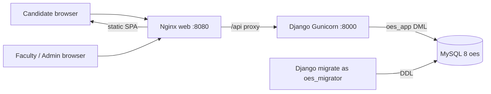
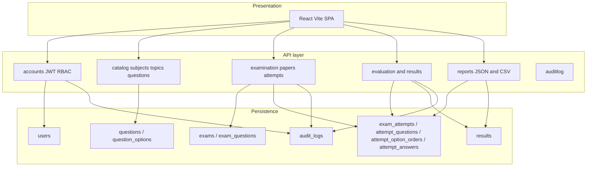
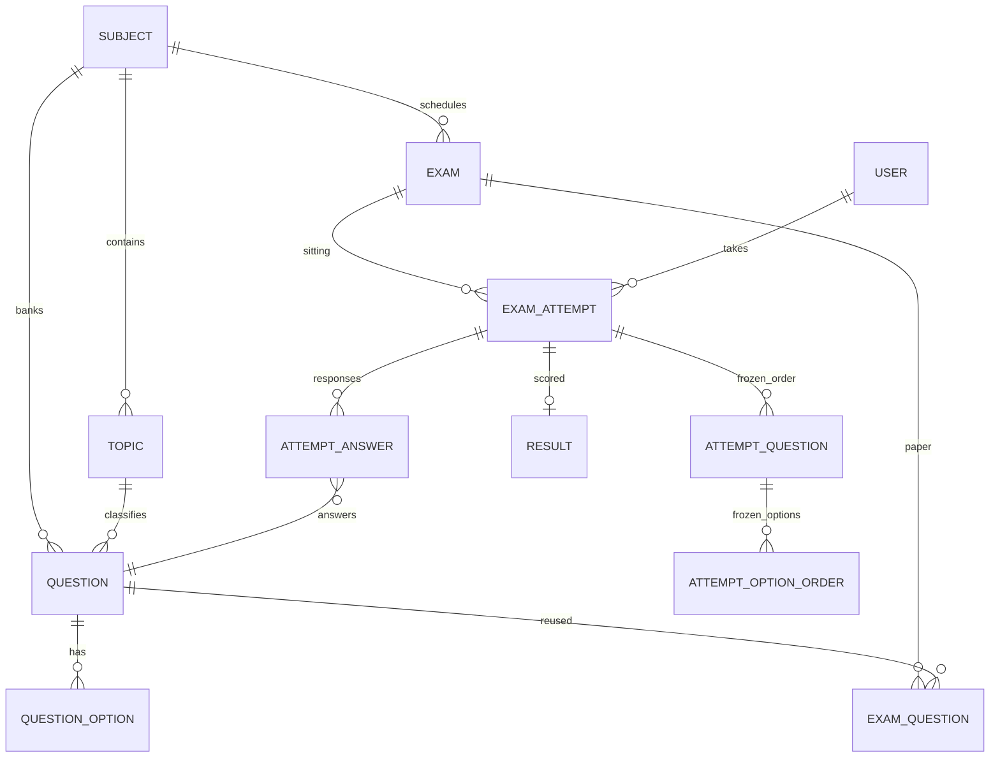
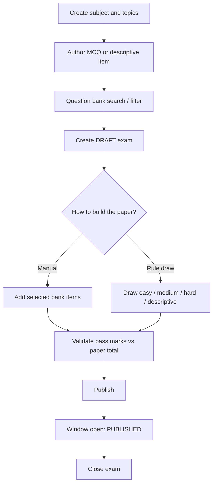
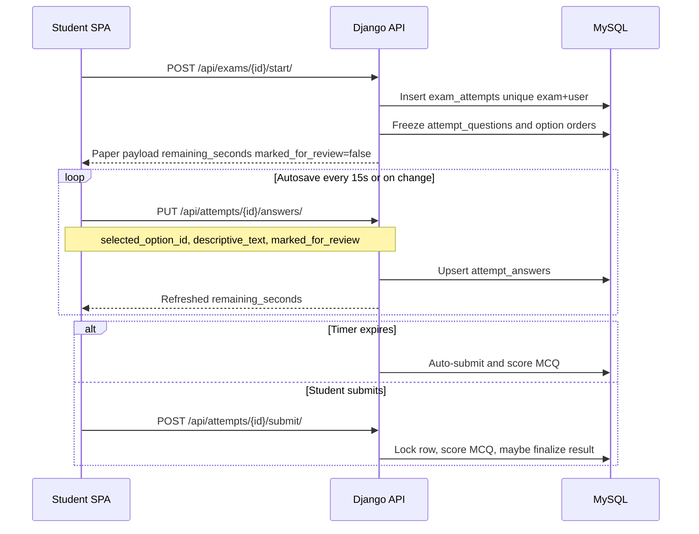
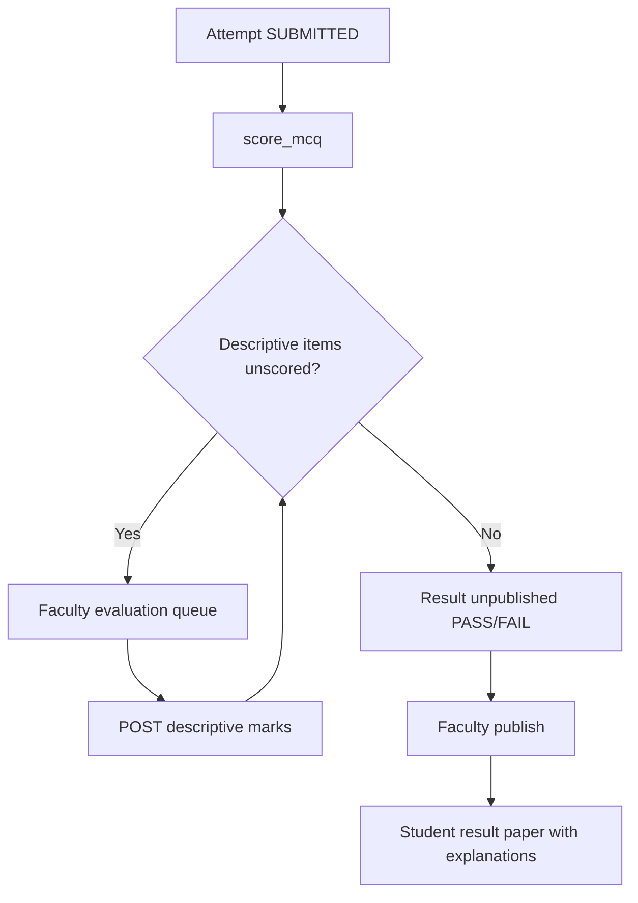
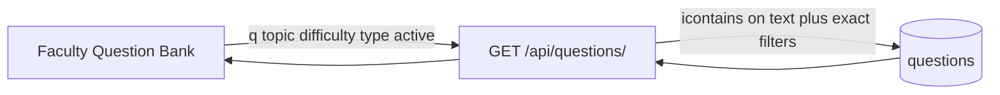

# Market Research & Professional Architecture Analysis (BMAD Framework)

## 1. Executive Summary & Market Landscape

The global digital assessment and online examination market is valued at over **$8.5 billion (2025–2026)**, projected to grow at a CAGR of 16.5%. Modern learning management systems (Canvas, Blackboard, Moodle) and dedicated assessment suites (Talview, Mercer Mettl, Examity) compete on reliability, attempt integrity, scalable concurrency, and granular reporting.

This assessment reviews the **ONLINE EXAMINATION SYSTEM** using the **BMAD** (Business, Market, Architecture, Design) evaluation framework. The product is scoped to IGNOU MCSP-232 Phase 1: a server-validated institutional exam engine. It does **not** implement AI proctoring, webcam or microphone lockdown, face recognition, OTP, CAPTCHA, or coding sandboxes.

Phase 1 now also covers three assessment-centre capabilities that commercial CAT-style papers and faculty workbenches treat as table stakes:

1. **Mark for review** during a live attempt, persisted on the server and shown on the question palette.
2. **Question-bank search and filters** (topic, difficulty, keyword).
3. **CSV export** of exam and institution performance summaries for faculty and admin.

---

## 2. BMAD Analysis

### B — Business Model & Value Proposition

* **Core value:** Standardized, server-validated examination engine. The client cannot extend the timer, start a second attempt, or mutate frozen option order.
* **Target segments:** Universities, competitive-exam bodies, certification centres, internal corporate L&D assessments.
* **Differentiation:** No proprietary lockdown client. Attempt state is frozen in MySQL (`attempt_questions`, `attempt_option_orders`, `attempt_answers.marked_for_review`). Audit rows (`LOGIN`, `START`, `SAVE`, `SUBMIT`, `EVALUATE`, `PUBLISH`) give a non-repudiable trail.
* **Monetizable Phase 1 extras (in scope):** Review flags, bank search, CSV compliance export. These reduce faculty operational cost without expanding into proctoring.

### M — Market Standards & Competitive Benchmarks

| Benchmark feature | Standard commercial solutions | ONLINE EXAMINATION SYSTEM (current) | Future phase target |
| :--- | :--- | :--- | :--- |
| Authentication | SAML/SSO + OAuth2 + MFA | Argon2 + SimpleJWT RBAC | SAML/SSO |
| Attempt randomization | Fixed seeds per candidate | Frozen question and option permutations | Adaptive testing (CAT) |
| Review workflow | Palette flags (answered / not answered / marked) | `marked_for_review` on `attempt_answers` + palette states | Bookmark groups and navigator filters persisted after submit |
| Question bank | Topic, Bloom, difficulty, full-text | Topic, difficulty, type, `q=` stem search | QTI 3.0 import/export |
| Evaluation | Hybrid auto/manual scoring | Instant negative-mark floored MCQ + faculty descriptive queue | Multi-grader double-blind review |
| Reporting | CSV / PDF / LMS gradebook | JSON reports + CSV performance summary | PDF pack and SIS push |
| Integrity checks | Client webcam / AI monitors | Server clock, one attempt, transactional submit lock | Browser-focus audit events |
| Infrastructure | Containerized microservices | Docker Compose (MySQL 8, Django API, Nginx web) | Kubernetes autoscaling |

### A — Architectural Integrity & 3NF Schema

* **Separation of bank vs exam:** Exams do not own questions; they link via `exam_questions`.
* **State freezing:** Candidates receive unique question orders (`attempt_questions`) and randomized option sequences (`attempt_option_orders`).
* **Review flag:** `attempt_answers.marked_for_review` is a candidate convenience flag. It never affects scoring.
* **Least-privilege database access:**
  * `oes_migrator`: DDL for schema changes and migrations.
  * `oes_app`: DML only (`SELECT`, `INSERT`, `UPDATE`, `DELETE`).
* **Strict transaction isolation:** Attempt start, answer autosave, and descriptive grading run inside `transaction.atomic()`.

### D — UI/UX & Design System

* **Design philosophy:** Enterprise dashboard (Inter, slate/blue palette, high-contrast states).
* **Candidate experience:** Tabular clock with a late warning under 60 seconds, palette with answered / marked / current states, mark-for-review toggle, autosave indicator.
* **Faculty/admin workspace:** Filterable question bank, inline grading queue, candidate result table, one-click CSV export.

---

## 3. Architecture diagrams

### 3.1 Deployment topology



The Compose stack is three services: `mysql`, `backend`, and `web`. The SPA is built with Vite and served by Nginx. `/api` is reverse-proxied to Gunicorn. Health is `GET /api/health/`.

### 3.2 Logical application architecture



### 3.3 Domain relationship sketch



Reports are queries. There is no report table.

---

## 4. Workflow diagrams

### 4.1 Faculty paper authoring



Inactive or cross-subject items cannot be added. Publish fails if the paper is empty, any item is inactive, or `pass_marks` exceeds the paper total.

### 4.2 Live attempt conduction



One attempt per student per exam. The deadline is `min(started_at + duration, exam.end_at)`. Negative marking on MCQ cannot take the objective total below zero. `marked_for_review` is stored with the answer and ignored by `score_mcq`.

### 4.3 Evaluation and result publish



Students cannot read the paper after submit until the result is published. Staff cannot read an in-progress attempt.

### 4.4 Question-bank search



### 4.5 Report export

```mermaid
flowchart TD
  Faculty[Faculty exam report UI] --> JSON[GET /api/reports/faculty/exams/{id}/]
  Faculty --> CSV[GET /api/reports/faculty/exams/{id}/export/]
  Admin[Admin summary UI] --> AJSON[GET /api/reports/admin/summary/]
  Admin --> ACSV[GET /api/reports/admin/summary/export/]
  CSV --> File[UTF-8 BOM CSV: summary + candidates + topic analysis]
  ACSV --> Inst[UTF-8 BOM CSV: institution totals + per-exam rows]
```

CSV is a query over existing tables. Role gates match the JSON reports: faculty/admin for exam export, admin only for institution export.

---

## 5. Scope boundaries (MCSP-232)

Implemented in Phase 1:

* RBAC (STUDENT / FACULTY / ADMIN), Argon2, SimpleJWT
* Question bank, draft/publish/close, rule-based draw
* One attempt, server timer, autosave, frozen shuffle
* Mark for review, bank search, CSV performance export
* Objective scoring with negative-mark floor, descriptive marking, result publish
* Audit log, `oes_migrator` vs `oes_app`

Explicitly out of Phase 1 (must not be claimed):

* AI proctoring, webcam, microphone, face recognition
* Browser lockdown, OTP, CAPTCHA, IP whitelist
* Automated coding judge or sandbox

---

## 6. Recommended roadmap (still future)

1. **SSO & directory federation:** SAML 2.0 / OpenID Connect.
2. **QTI 3.0:** Bulk question-bank interchange.
3. **Double-blind evaluation:** Multi-evaluator assignment with discrepancy flags.
4. **Browser-focus audit:** Record blur/focus events without claiming proctoring.
5. **PDF candidate pack:** Printable counterpart to the CSV summary.
